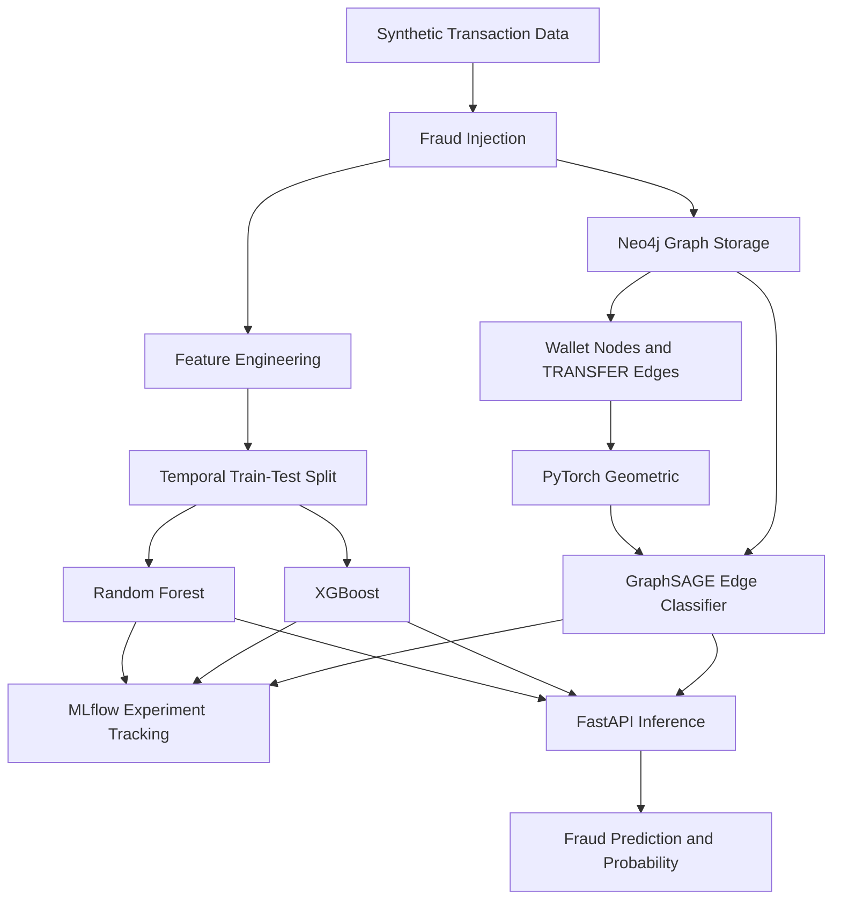

# Central Bank Digital Currency Intelligence Engine

An end-to-end machine learning and graph ml intelligence platform for detecting suspicious transactions in synthetic CBDC-like payment networks. Combines traditional machine learning, Graph Neural Networks, Neo4j graph storage, MLflow experiment tracking and FastAPI inference.

# What is a Central Bank Digital Currency (CBDC)?

A Central Bank Digital Currency (CBDC) is a European digital form of a country's official currency, issued and backed by its central bank. It aims to make digital payments faster, more accessible and efficient in the future. As money becomes increasingly digital, CBDCs represent one possible direction for the future of currency, alongside cash, bank deposits, and existing digital payment systems.

However, as CBDC research being going on European Central Bank, access to that real transaction data is restricted due to privacy and confidentiality. This project aims to **develop and evaluate a model fraud detection system using synthetic CBDC-like transaction data**, combining traditional machine learning, Graph Neural Networks and Neo4j to work on Digital currency level.


**Status:** Building — Core ML pipeline and API implemented.

## Overview

Financial fraud can involve more than individual transactions. Suspicious behaviour may emerge from unusual transaction amounts, high-frequency transfers, account takeover patterns, and relationships between wallets.

This project explores a multi-model approach to transaction fraud detection by combining tabular machine learning with graph-based behavioural analysis.

The system uses three models:

- **Random Forest** — detects suspicious patterns in transaction features.
- **XGBoost** — provides a gradient-boosted classification baseline.
- **GraphSAGE** — learns wallet representations from transaction relationships and performs edge-level fraud classification.

All three models are accessible through a unified FastAPI endpoint.

> **Data note:** The project uses synthetic CBDC-like transaction data with deliberately simulated fraud patterns. The dataset does not contain real central bank transaction records, and the reported metrics should not be interpreted as real-world banking performance.

## Architecture



## Key Features

### 1. Synthetic Data and Fraud Simulation

- Generated a dataset of 100,000 transactions for a simulated wallet payment network.
- Implemented six fraud scenarios: account takeover, high-frequency bursts, smurfing/structuring, mule-chain behaviour, unusual spending, and circular transfers.
- Engineered behavioural and transaction features, including velocity, transaction frequency, amount deviations, device changes, location changes, and balance-related attributes.

### 2. Traditional Machine Learning

Implemented separate training pipelines for Random Forest and XGBoost.

- Chronological train-test splitting to evaluate models on later transactions.
- Numerical preprocessing and categorical encoding through scikit-learn pipelines.
- Evaluation using precision, recall, F1-score, ROC-AUC, PR-AUC, and confusion matrices.
- MLflow tracking for experiment parameters, evaluation metrics, and model artifacts.

### 3. Graph-Based Fraud Detection

Represented the payment network as a directed graph:

- **Nodes:** Wallets.
- **Edges:** Transfers between wallets.
- **Node features:** Eight wallet-level behavioural and network statistics.
- **Edge features:** Five transaction attributes.
- **Target:** Binary transaction-level fraud classification.

Neo4j stores and queries the wallet transaction network, while PyTorch Geometric converts the graph into tensors for GraphSAGE training and inference.

The model aggregates information from neighbouring wallets, combines source and destination wallet embeddings with transaction features, and predicts the probability that a transfer is fraudulent.

The graph contains approximately 12,000 wallet nodes and 100,000 transfer relationships.

### 4. FastAPI Inference Service

Integrated all three trained models behind a single endpoint:

`POST /predict`

The API accepts a JSON transaction object and returns individual predictions and fraud probabilities from Random Forest, XGBoost, and GraphSAGE.

Example response:

```json
{
  "random_forest": {
    "prediction": "normal",
    "fraud_probability": 0.0224
  },
  "xgboost": {
    "prediction": "normal",
    "fraud_probability": 0.0
  },
  "gnn": {
    "prediction": "normal",
    "fraud_probability": 0.0448
  }
}
```

The values above are an example from a successful local API test, not general performance metrics. GNN inference retrieves wallet transaction history from Neo4j to construct the graph used for prediction.

## Model Evaluation

Results from the synthetic dataset:

| Metric | Random Forest | XGBoost | GraphSAGE v5 |
|---|---:|---:|---:|
| Precision |  |  |  |
| Recall |  |  |  |
| F1-score |  |  |  |
| ROC-AUC |  |  |  |
| PR-AUC | |  |  |

**Interpretation:** These results demonstrate that the models learn the deliberately constructed signals in the synthetic dataset. The exceptionally high Random Forest and XGBoost scores are influenced by the simulated fraud patterns and should not be taken as evidence of equivalent performance on real financial transactions.

GraphSAGE uses a separate graph-based representation and is evaluated using a chronological split, with the decision threshold selected using validation data.

## Technology Stack

| Category | Technologies |
|---|---|
| Language | Python |
| Data processing | pandas, NumPy |
| Traditional ML | scikit-learn, XGBoost |
| Graph ML | PyTorch, PyTorch Geometric, GraphSAGE |
| Graph database | Neo4j |
| Experiment tracking | MLflow |
| API | FastAPI, Uvicorn |
| Model persistence | joblib, PyTorch checkpoints |
| Version control | Git, GitHub |

## Project Structure

```text
central-bank-digital-currency-intelligence-engine/
├── data/
│   ├── raw/
│   ├── processed/
│   └── inference/
├── src/
│   ├── data/
│   ├── features/
│   ├── models/
│   ├── evaluation/
│   ├── api/
│   │   ├── inference.py
│   │   ├── gnn_inference.py
│   │   └── main.py
│   ├── graph/
│   │   ├── extract_graph.py
│   │   └── train_gnn.py
│   └── test/
├── tests/
├── notebooks/
├── configs/
├── models/
├── requirements.txt
├── .gitignore
└── README.md
```

## Running the API Locally

### Prerequisites

- Python 3.12
- Neo4j with the project transaction graph loaded
- Trained Random Forest, XGBoost, and GraphSAGE model artifacts
- Project dependencies installed in a virtual environment

### 1. Clone the repository

```bash
git clone https://github.com/Harin22/central-bank-digital-currency-intelligence-engine.git
cd central-bank-digital-currency-intelligence-engine
```

### 2. Create and activate a virtual environment

```powershell
python -m venv .venv
.venv\Scripts\Activate.ps1
```

### 3. Install dependencies

```powershell
pip install -r requirements.txt
```

### 4. Configure Neo4j

Create a local `.env` file in the project root:

```env
NEO4J_URI=bolt://127.0.0.1:7687
NEO4J_USERNAME=neo4j
NEO4J_PASSWORD=your_password
NEO4J_DATABASE=cbdc
```

Ensure the Neo4j database is running and contains the expected `Wallet` nodes and `TRANSFER` relationships. Keep `.env` and credentials out of version control.

### 5. Start FastAPI

```powershell
uvicorn src.api.main:app --reload
```

Open the interactive API documentation:

http://127.0.0.1:8000/docs

Use `POST /predict` to submit a valid transaction JSON object and inspect the three model predictions.

**Note:** The API requires the trained model artifacts and graph database configuration. Docker-based packaging and deployment are not yet implemented.

## Future Work

- **Containerization:** Package the API and inference dependencies using Docker, with secure environment-based configuration and connectivity to Neo4j.
- **CI/CD:** Automate testing and validation through a GitHub Actions pipeline.
- **Monitoring:** Introduce inference monitoring, model performance tracking, and data or prediction drift detection.
- **Deployment:** Deploy the inference service to a cloud environment and validate its operational behaviour.

## Limitations

- The dataset is synthetic and does not represent actual CBDC transactions.
- Simulated fraud patterns may make classification easier than real-world fraud detection.
- Graph inference currently uses wallet history retrieved from Neo4j; production-scale graph serving and latency optimisation remain future work.
- The project is a fraud detection prototype, not a production banking or payment system.

## License

This project is licensed under the MIT License. See the `LICENSE` file for details.
